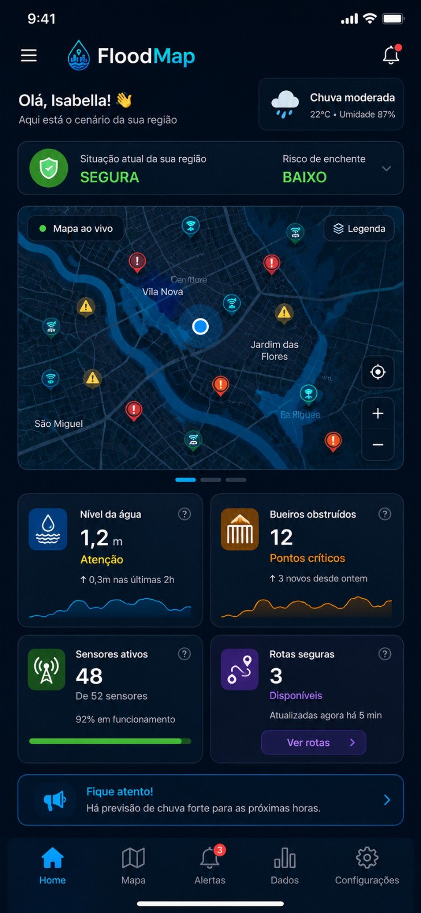
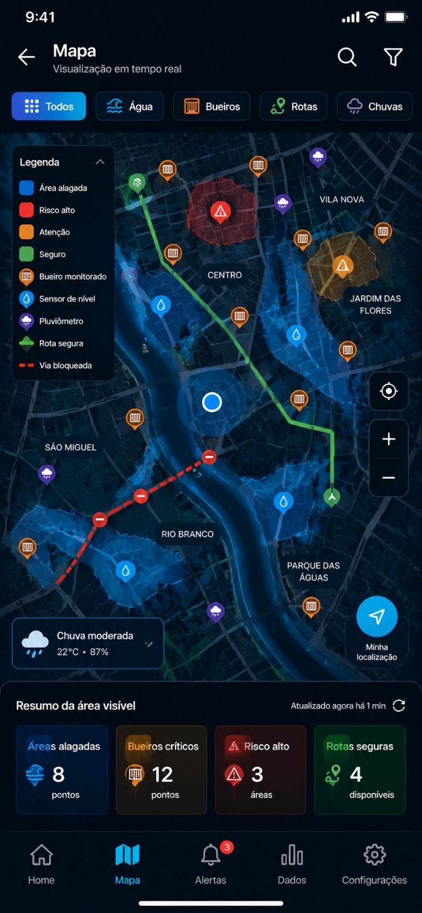
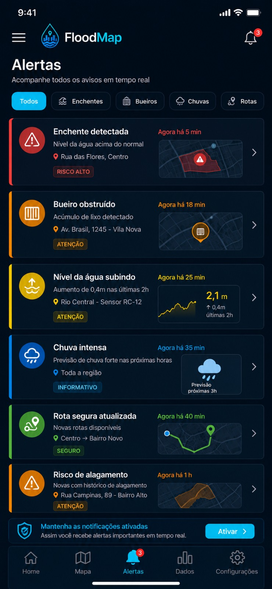

# 🌧️ FloodMap · Monitoramento inteligente de enchentes

Site oficial da **FloodMap**, startup que criamos em um projeto da faculdade a partir de uma ODS da ONU, para enfrentar **as enchentes que atingem as cidades brasileiras todos os anos**.

🔗 **Acesse o site:** https://isabella-cavalcanti.github.io/FloodMap1.0/

## O problema
O Brasil tem mais de **R$ 10 bilhões** em prejuízos por ano com enchentes e alagamentos, e mais de **8 milhões de pessoas** vivem em áreas de risco. Os alertas que existem hoje são genéricos: não dizem se a *sua* rua está em risco nem por onde sair.

## A solução
Uma plataforma **IoT + app** que:
- monitora bueiros e pontos de risco com **sensores** de baixo custo (ESP32 + sensores ultrassônicos) que medem o **nível da água** e o **acúmulo de lixo**;
- envia **alertas geolocalizados**, só para quem está na área de risco;
- calcula **rotas seguras** de evacuação em tempo real, desviando das áreas alagadas;
- oferece um **dashboard** para prefeituras e Defesa Civil.

## O que tem neste repositório
O site da empresa, com:
- apresentação, missão, visão e valores;
- o protótipo dos sensores;
- as **telas do protótipo do app**: login, home, mapa ao vivo, alertas, rotas seguras, dados e planos;
- a equipe.

| Home | Mapa ao vivo | Alertas |
|---|---|---|
|  |  |  |

## Tecnologias
HTML · CSS · JavaScript · GitHub Pages

## Equipe
| Nome | Papel |
|---|---|
| Giulia Néias Cavalheri | Fundadora / CEO |
| Nicole Molina | Diretora de Operações |
| **Isabella Cavalcanti** | **Diretora de Tecnologia**: desenvolvimento do site e do protótipo do app |
| Leticia Patricio | Marketing e Relacionamento |

## O que eu aprendi
Foi o meu primeiro contato com HTML, e criar um site do zero foi bem mais complexo do que eu imaginava. Mesmo usando IA como apoio, precisei entender a estrutura de cada página, o CSS e o JavaScript para fazer tudo funcionar junto e no ar. Foi esse projeto que me fez perder o medo de começar algo do zero.
